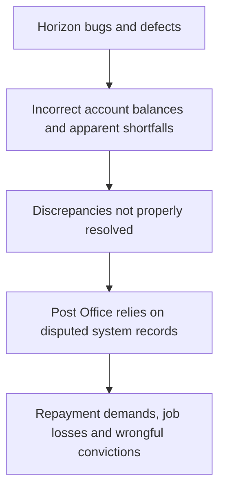

# Failure Case Analysis: Post Office Horizon Accounting System

**Version:** v1.0  
**Date:** 2026-10-21

## 1. Context

The Horizon accounting system was introduced by the UK Post Office in 1999. It was developed to record financial transactions at Post Office branches. However, software defects and problems with the handling of discrepancies contributed to serious consequences for many sub-postmasters.

## 2. Timeline

- **1999:** The Horizon system was introduced in Post Office branches.
- **2000s:** Sub-postmasters reported discrepancies between the system's records and their accounts.
- **2010s:** Concerns about Horizon's reliability and the treatment of sub-postmasters received greater public attention.
- **2019:** A High Court judgment examined serious issues relating to Horizon and the Post Office's approach to discrepancies.
- **2024:** The UK passed legislation to quash many convictions connected to the scandal and provide a route to compensation.

## 3. What failed

Horizon had bugs that caused apparent shortfalls in some Post Office branch accounts. The Post Office relied on its records without properly resolving some discrepancies. Instead, it should have investigated the errors before blaming sub-postmasters. These failures contributed to job losses, repayment demands, and wrongful prosecutions and convictions.

## 4. Root Causes

- **Technical problems:** Software defects could cause incorrect balances or unexplained discrepancies.
- **Weak investigation:** Reported problems were not always investigated adequately.
- **Overreliance on system records:** System outputs were treated as reliable evidence without sufficient independent verification.
- **Poor communication and accountability:** Concerns raised by sub-postmasters were not handled appropriately.

## 5. Practices That Could Have Prevented the Failure

- Test the software thoroughly before and after deployment.
- Investigate unexpected account differences before taking action against users.
- Maintain accurate logs and provide ways to audit system changes.
- Allow users to report defects and receive timely responses.
- Ensure independent reviews of serious technical disputes.
- Train staff to understand the system's limitations and reporting procedures.

## 6. Lessons for ITC Club Hub

Our ITC Club Hub project should apply these lessons by:

- Testing important features before releasing them.
- Keeping clear records of changes and errors.
- Verifying important information instead of trusting system output blindly.
- Giving users a clear way to report problems.
- Reviewing bugs and fixing them before they cause further issues.
- Using Git branches and code reviews to reduce mistakes when collaborating.

## 7. Sources

1. **Bates v Post Office Ltd [2019] EWHC 3408 (QB)** — High Court judgment concerning Horizon issues.
2. **UK Parliament** — Legislation and parliamentary materials concerning the Post Office Horizon scandal.
3. **UK public inquiry into the Post Office Horizon IT scandal** — Evidence and reports concerning the system and its effects.

